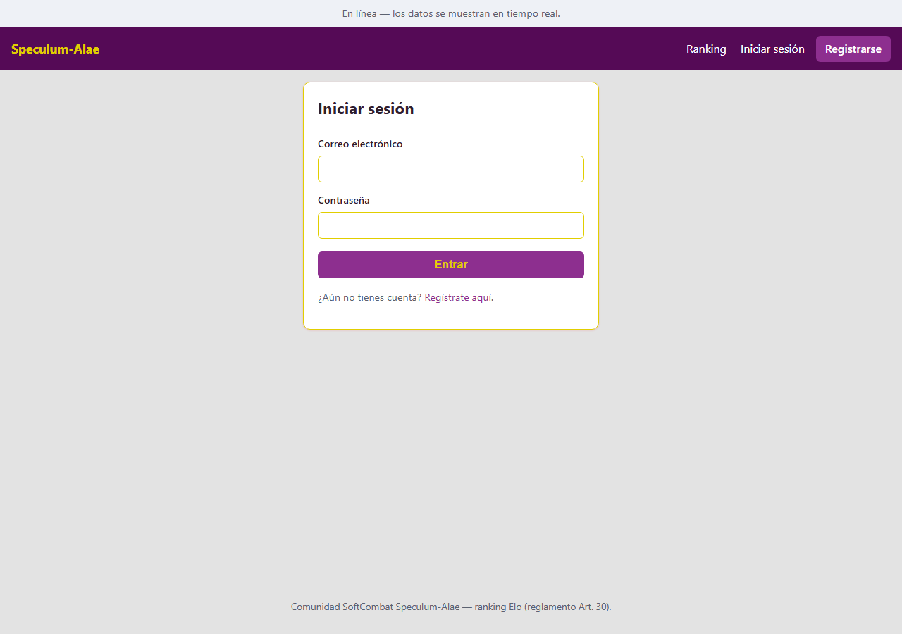
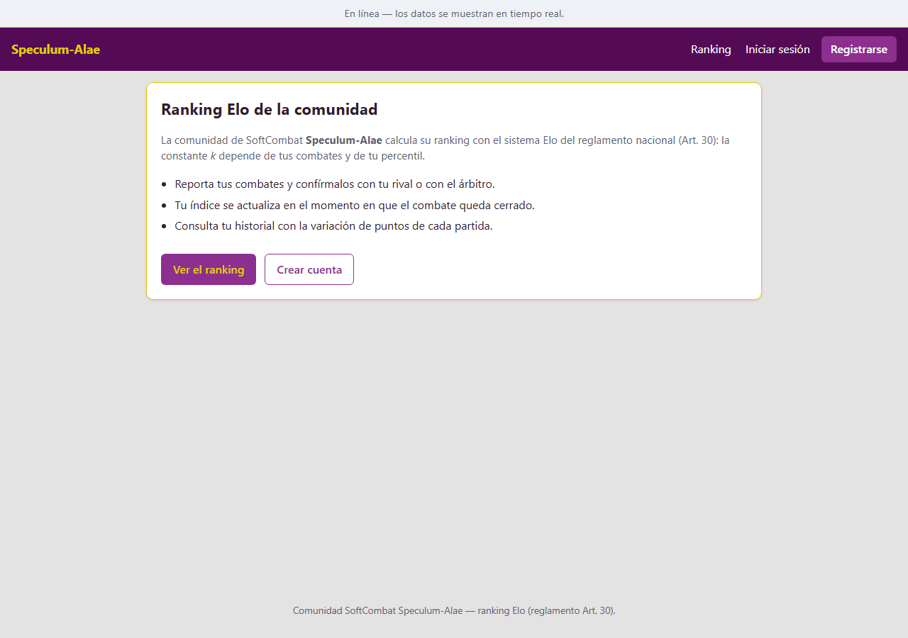
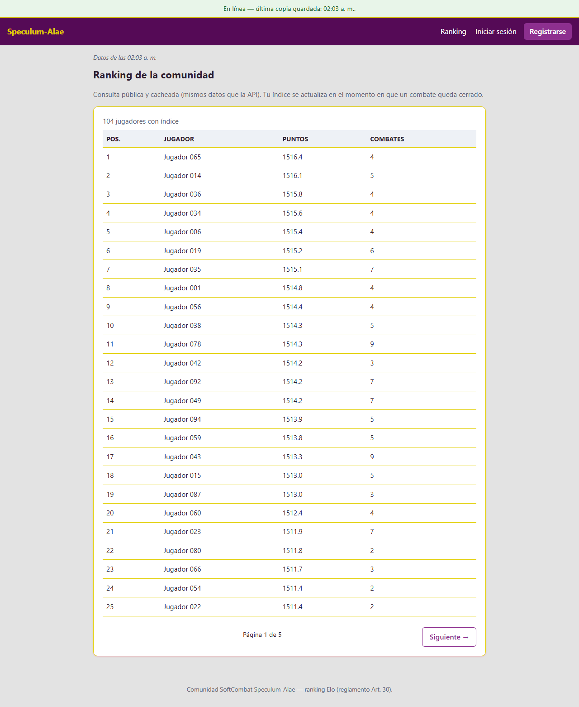
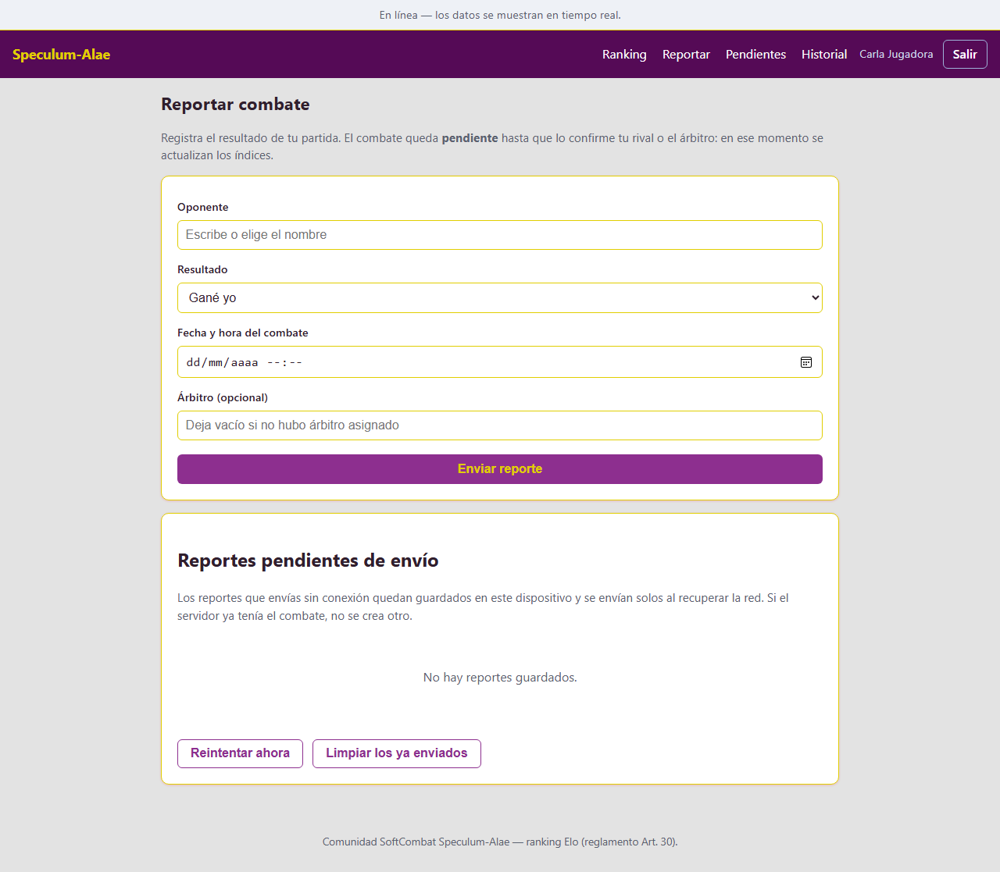
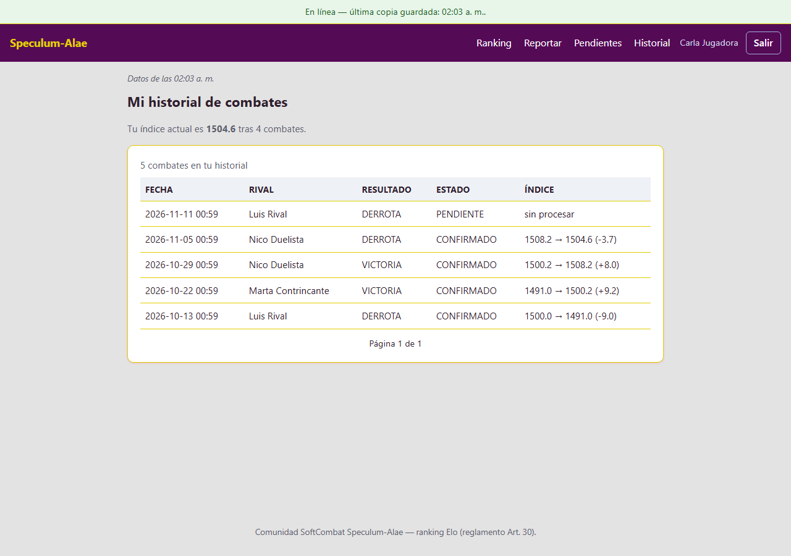
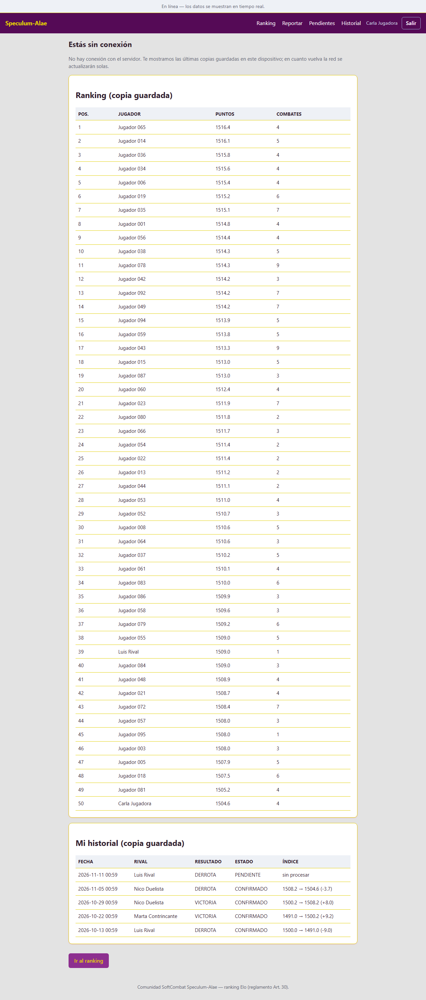
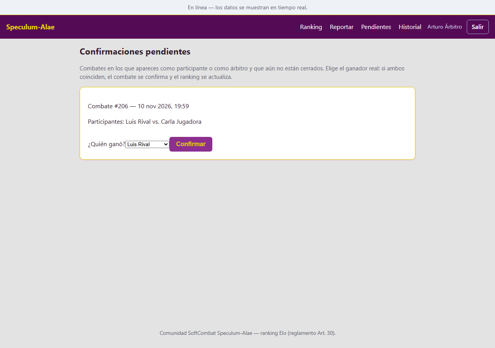
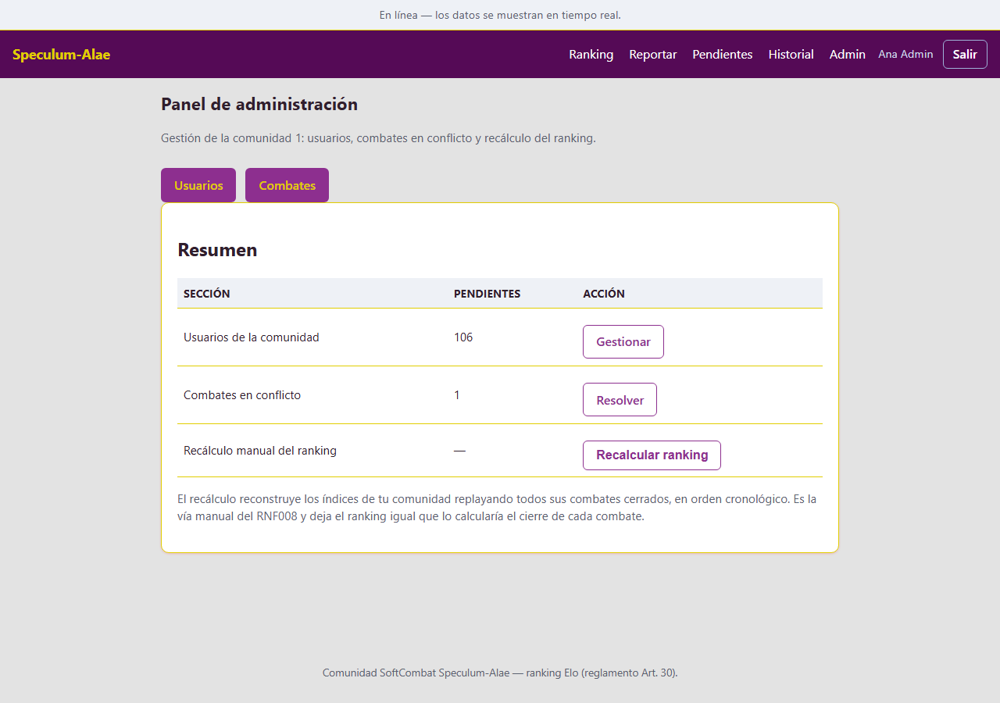
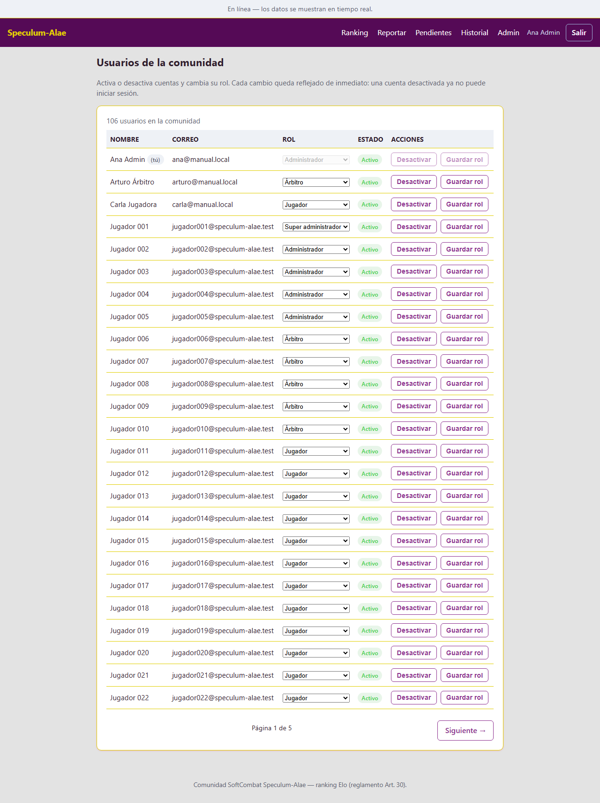
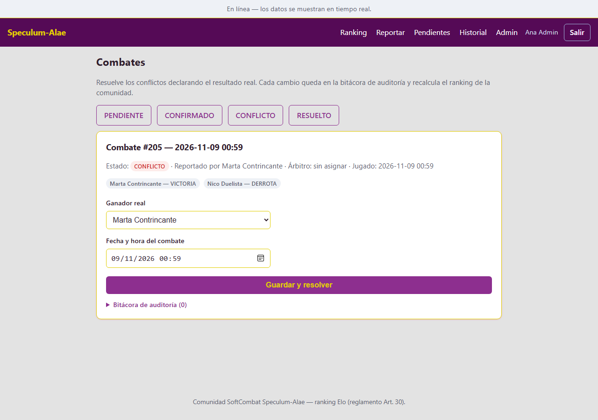

# Manual de usuario — Speculum-Alae

Guía breve por rol de la PWA del ranking Elo de la comunidad SoftCombat
Speculum-Alae. Cada apartado muestra los pasos a seguir y la captura real de
la pantalla correspondiente.

**Roles del sistema:**

| Rol | Puede hacer |
| --- | --- |
| **Jugador** | Consultar el ranking, reportar combates, confirmar los suyos y ver su historial. |
| **Árbitro** | Lo mismo que un jugador, además de cerrar los combates que tiene asignados (su confirmación prevalece). |
| **Administrador** | Todo lo anterior más gestionar usuarios, resolver conflictos con bitácora de auditoría y recalcular el ranking. |

El ranking (`/ranking`) es **público**: cualquier visitante lo consulta sin
iniciar sesión.

---

## Cuentas del escenario de demostración

Las capturas se tomaron sobre un escenario sembrado con estas cuentas
(contraseña `password123` en todas):

| Correo | Nombre | Rol |
| --- | --- | --- |
| `carla@manual.local` | Carla Jugadora | jugador |
| `luis@manual.local` | Luis Rival | jugador |
| `marta@manual.local` | Marta Contrincante | jugador |
| `nico@manual.local` | Nico Duelista | jugador |
| `arturo@manual.local` | Arturo Árbitro | árbitro |
| `ana@manual.local` | Ana Admin | administrador |

El escenario trae 4 combates cerrados (índices calculados), un conflicto sin
resolver y un combate pendiente con árbitro asignado.

---

## 1. Iniciar sesión o registrarse

Abre la aplicación en el navegador. Desde **Iniciar sesión** entra con tu
correo y contraseña; si aún no tienes cuenta, usa **Registrarse** (nombre,
correo y contraseña).



## 2. Portada

La portada es pública y ofrece acceso directo al ranking y al registro.



## 3. Consultar el ranking (cualquier visitante)

Menú **Ranking** (sin sesión): tabla con posición, jugador, puntos y número
de combates de cada miembro de la comunidad, paginada. Los puntos se
actualizan en el momento en que un combate queda cerrado.



---

## Jugador

### 4. Reportar un combate

1. Inicia sesión (por ejemplo `carla@manual.local`).
2. Menú **Reportar**.
3. Escribe el **oponente** (aparece la lista de la comunidad), elige el
   **resultado** (gané yo / ganó el oponente), la **fecha y hora** y, si
   hubo árbitro, su nombre.
4. Pulsa **Enviar reporte**. El combate queda *pendiente* hasta que lo
   confirme tu rival o el árbitro: en ese momento se actualizan los índices.
5. Si estás sin conexión, el reporte se guarda en el dispositivo (tarjeta
   «Reportes pendientes de envío») y se envía solo al recuperar la red; si el
   servidor ya lo tenía, no se crea otro.



### 5. Confirmar combates pendientes

Menú **Pendientes**: aparecen los combates en los que participas (o en los
que eres árbitro) y que aún no están cerrados. Elige el **ganador real** y
pulsa **Confirmar**. Si ambos participantes declaran el mismo ganador, el
combate se confirma y el ranking se recalcula al instante; si discrepan, el
combate pasa a conflicto (lo resuelve un administrador o el árbitro).


### 6. Mi historial

Menú **Historial**: todos tus combates con rival, resultado, estado y la
variación de tu índice (`antes → después (Δ)`) en cada cierre.



### 7. Copias sin conexión (PWA)

La aplicación se instala como PWA y guarda copias del ranking y de tu
historial en el dispositivo. La página **`/offline`** (respaldo del service
worker) las muestra cuando no hay red; la cabecera indica además la hora de
la última copia guardada.



---

## Árbitro

### 8. Confirmar como árbitro

Con la cuenta de un árbitro (por ejemplo `arturo@manual.local`), menú
**Pendientes**: además de sus propios combates, el árbitro ve los que tiene
**asignados**. Su confirmación **cierra el combate de inmediato y prevalece**
sobre lo que hayan declarado los participantes.



---

## Administrador

Las tres páginas del panel solo responden a roles `admin`/`super_admin` de la
misma comunidad (con sesión, el menú muestra **Admin**).

### 9. Portada del panel

Resumen de la comunidad: número de usuarios, combates en conflicto y acceso
al **recálculo manual del ranking** (botón *Recalcular ranking*, con
confirmación previa), la vía manual del RNF008.



### 10. Gestionar usuarios

Botón **Gestionar**: tabla con nombre, correo, rol (desplegable), estado y
acciones. Desde aquí se activa/desactiva cuentas y se cambian roles; nadie
puede desactivarse ni cambiarse su propio rol, y solo un `super_admin`
concede o quita `super_admin`.



### 11. Resolver conflictos y auditar

Botón **Resolver** (filtro por estado, por defecto `CONFLICTO`): cada tarjeta
muestra el combate, sus dos declaraciones y el formulario **«Ganador real»**
con fecha. Al **Guardar y resolver** el combate pasa a `RESUELTO`, se
recalculan los índices y la **Bitácora de auditoría** registra quién cambió
qué (campo, valor anterior, valor nuevo).



---

## Notas

- **Contraseñas de demostración:** las cuentas de arriba existen solo en la
  base de datos local de desarrollo; no usarlas en un despliegue real.
- **Regenerar las capturas** (requiere Edge/Node):

  ```bash
  venv/bin/python scripts/capturar_manual_usuario.py
  ```

  El script siembra el escenario (idempotente), levanta el prototipo en un
  puerto efímero y vuelve a tomar las 11 capturas en `documentation/capturas/`.
- Si confirmaste a mano el combate pendiente del escenario, borra
  `prototype/instance/app.db`, vuelve a migrar
  (`flask --app run.py db upgrade`) y regenera las capturas para restaurar el
  estado inicial.
- La página `/offline` muestra las copias solo después de haber visitado el
  ranking y el historial estando en línea (el service worker los guarda como
  «stale-while-revalidate»).
